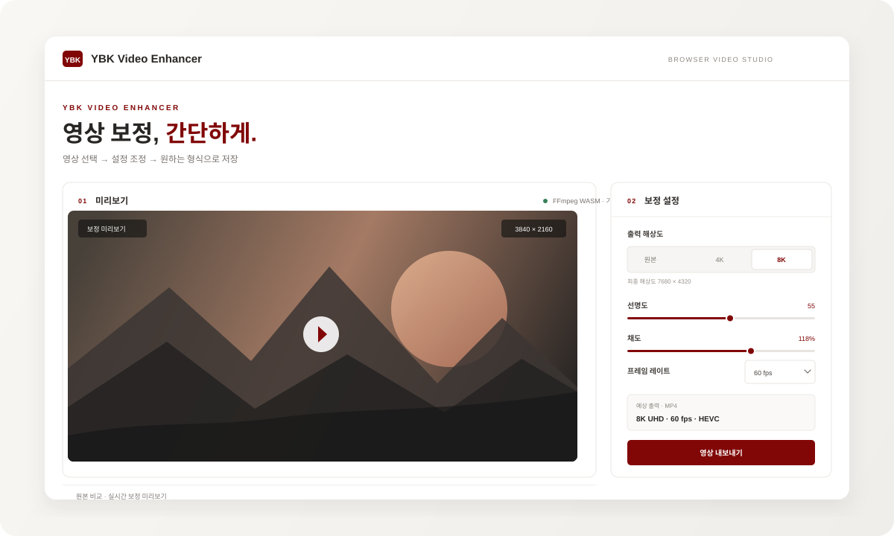
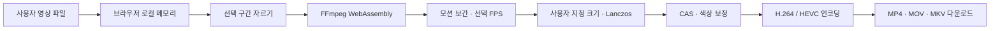

	

<h1 align="center">YBK Video Enhancer</h1>

	영상 선택부터 보정·저장까지, 브라우저에서 간편하게.

	
	
	

	

화면 구성 미리보기 — 실제 영상은 브라우저에서 처리되며 서버에 업로드되지 않습니다.

---

## 주요 기능

| 기능 | 설명 |
| --- | --- |
| 파일 불러오기 | 영상 파일 선택 또는 미리보기 영역에 드래그 앤 드롭 |
| 영상 자르기 | 시작·끝 시점을 초 단위로 지정하고 선택 구간만 저장 |
| 보정 미리보기 | 선명도, 채도, 대비, 밝기 조절 및 원본 비교 |
| 프레임 보간 | FFmpeg `minterpolate` 기반 모션 보간, 원본·24·30·60·120 fps 선택 |
| 출력 크기 | 원본 유지, 4K·8K UHD 또는 사용자 지정 너비·높이 선택, 원본 비율 유지 옵션 |
| 이미지 보정 | Lanczos 리사이즈, CAS 선명화, 색상·대비·밝기 조정 |
| 저장 옵션 | MP4, MOV, MKV 컨테이너와 사용 가능한 H.264 / HEVC 코덱 선택 |
| 로컬 처리 | 파일 내용을 업로드하지 않고 브라우저의 FFmpeg WebAssembly로 처리 |
| 브랜드 공유 | YBK Studio 로고, 파비콘, Open Graph 및 Twitter 미리보기 메타데이터 |

## 사용 방법

1. `index.html`을 브라우저에서 엽니다. 개발 중에는 VS Code의 Live Server 같은 정적 파일 미리보기를 사용할 수 있습니다.
2. 영상을 선택하거나 미리보기 영역에 놓습니다.
3. 시작·끝 시점을 지정해 필요한 구간만 자르고, 출력 해상도나 사용자 지정 크기 및 보정값을 정합니다. 필요하면 FPS·인코딩 옵션도 선택합니다.
4. **영상 내보내기**를 누릅니다. 첫 내보내기 시 FFmpeg WebAssembly 엔진을 내려받은 뒤 브라우저에서 처리를 시작합니다.
5. 처리가 끝나면 선택한 형식의 결과 파일이 다운로드됩니다.

> 이 프로젝트에는 영상 처리를 위한 애플리케이션 서버가 없습니다. 웹사이트는 정적 HTML/CSS/JavaScript이며, FFmpeg 엔진과 코어 파일은 첫 사용 때 CDN에서 로드됩니다. 영상 파일 자체는 외부로 전송되지 않습니다.

## 보정 파이프라인

### 처리 방식과 Python 스크립트의 차이

정적 웹 버전과 [interpolate_video.py](interpolate_video.py)는 일부 처리 목적은 비슷하지만, 프레임 보간 알고리즘이 동일하지 않습니다.

| 처리 항목 | 웹 브라우저 | Python 스크립트 |
| --- | --- | --- |
| 모션 보간 | FFmpeg `minterpolate` | OpenCV DIS 양방향 광학 흐름 |
| 업스케일 | FFmpeg Lanczos | FFmpeg Lanczos + accurate rounding |
| 선명화 | FFmpeg CAS 필터 (WASM 빌드 지원 시) | FFmpeg CAS 필터 |
| 인코딩 | WASM 빌드에 포함된 H.264 / HEVC | VideoToolbox 또는 libx265 |
| 오디오 | 호환 시 원본 복사, 필요하면 AAC 변환 | 원본 오디오 스트림 복사 |

따라서 웹 브라우저 결과가 Python DIS 결과와 픽셀 단위 또는 움직임 처리까지 같다고 보장하지 않습니다. OpenCV DIS와 동일한 결과가 필수라면 Python 스크립트를 사용해야 합니다. 이 웹사이트는 정적 사이트로 유지하기 위해 Python 처리 서버를 포함하지 않습니다.

## 출력 설정과 제한

- MP4, MOV, MKV 내보내기와 H.264 / HEVC 선택지는 현재 내려받은 FFmpeg WASM 빌드의 코덱 지원에 따릅니다. 호환되지 않는 옵션은 처리 중 오류로 안내됩니다.
- 파일은 약 2 GB 이하로 제한하는 것을 권장합니다. WebAssembly 메모리와 브라우저 환경에 따라 더 작은 파일도 처리하지 못할 수 있습니다.
- 4K와 8K는 특히 메모리 사용량이 크고, 처리 시간이 길 수 있습니다. 고해상도 입력, 긴 영상, 120 fps 설정은 기기 성능을 크게 요구합니다.
- 프레임 보간은 원본보다 낮은 FPS를 선택해도 프레임을 줄이는 작업은 하지 않습니다. 보간은 목표 FPS가 원본보다 높을 때만 적용됩니다.
- 브라우저용 엔진은 첫 내보내기 시 CDN에서 로드되므로 처음에는 네트워크 연결이 필요합니다. 로드에 실패하면 연결을 확인한 뒤 다시 시도하세요.
- 실제 인코딩 옵션·필터가 설치된 엔진에 없으면 해당 옵션을 실행할 수 없습니다. WASM 빌드가 CAS를 제공하지 않는 경우 선명도 설정을 0으로 낮춰야 할 수 있습니다.

## 파일 구성

| 파일 | 용도 |
| --- | --- |
| `index.html` | 페이지 구조, 설정 UI, 검색 및 링크 공유 메타데이터 |
| `styles.css` | 반응형 화면 디자인과 YBK 색상 테마 |
| `app.js` | 파일 선택, WebGL 미리보기, FFmpeg WASM 보정·내보내기 |
| `YBK Studio full logo.png` | 화면 및 문서에서 사용하는 기업 로고 |
| `favicon.svg` | 브라우저 탭용 YBK 파비콘 |
| `readme-preview.svg` | 이 문서의 인터페이스 구성 일러스트 |
| `interpolate_video.py` | 별도 실행하는 Python/OpenCV 처리 스크립트 |

## 링크 공유 미리보기 배포 설정

페이지에는 Open Graph와 Twitter 제목·설명·이미지 메타데이터가 있습니다. 정적 호스팅 후 링크 미리보기가 로고를 찾지 못하면 `index.html`의 `og:image`와 `twitter:image`를 배포된 로고의 **절대 HTTPS 주소**로 바꿔 주세요. 예를 들어 `/YBK%20Studio%20full%20logo.png` 대신 `https://도메인/YBK%20Studio%20full%20logo.png`를 사용합니다. 공유 플랫폼이 이전 미리보기 이미지를 보관할 수 있으므로, 배포 후 해당 플랫폼의 캐시 갱신 도구를 이용해야 할 수도 있습니다.
